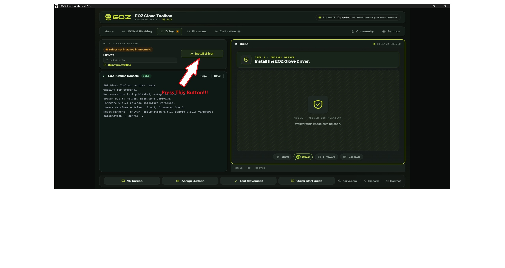
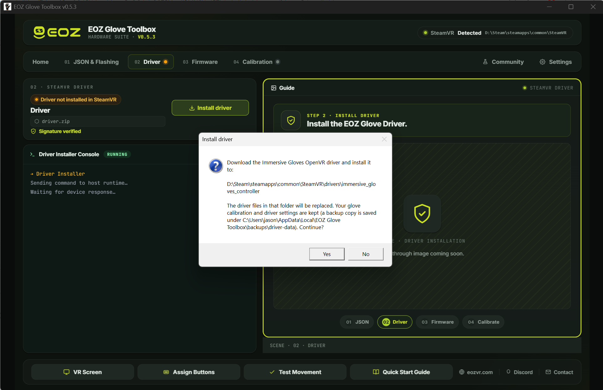

# Step 5 : Install driver

Choose **one** method. The automatic method is recommended.





## Close Steam / SteamVR

Make sure you also exit it from the system tray!



## Run the Toolbox




## Choose "DRIVER" Tab

You should see the screen below. 



<figure><figcaption></figcaption></figure>



## Update the driver

Click **Update driver**.



### Confirm the install prompt, click "Yes"

<figure><figcaption></figcaption></figure>



## Wait for installation

The Toolbox will download and install the latest driver. This can take 30 seconds to 2 minutes, depending on your internet speed.



## Continue

Once it completes successfully, go to the next step.




