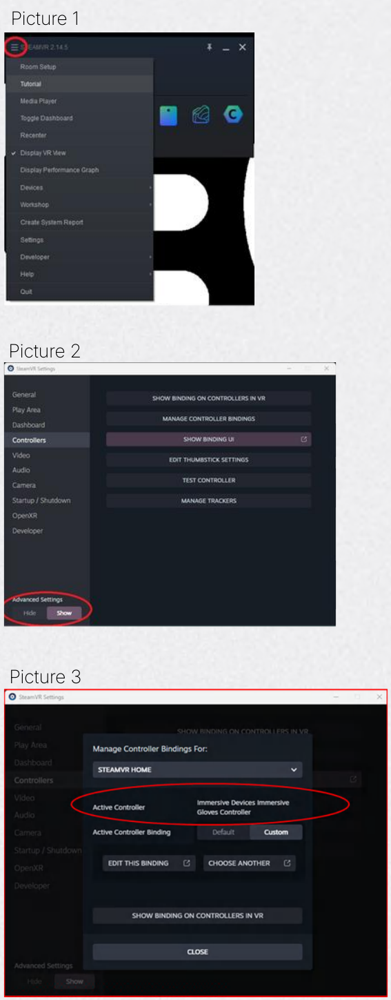

# Step 6: Edit bindings



## Open SteamVR Settings

Find **Settings** in your small SteamVR console window (picture 1).

Click the three lines to open the drop-down menu, then select **Settings**.



## Enable Advanced Settings

In Settings, make sure **Advanced Settings** is set to **Show** — bottom left (picture 2).



## Manage controller bindings

Select **Controllers** in the left menu, then click **Manage Controller Bindings** (picture 2).



## Verify the active controller

The active controller should show **Immersive Devices Immersive Glove Controller** (picture 3).


If you don't see **Immersive Devices Immersive Glove Controller**, the driver isn't installed correctly. Go back and redo [Step ](step-5-install-driver.md)5.



