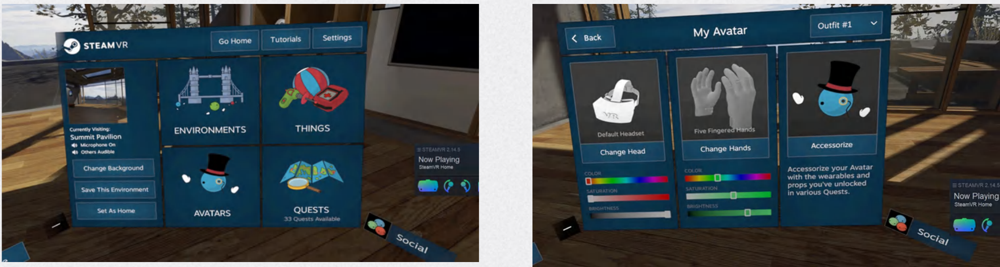

# Step 7: Edit Steamvr Home & Tadaaaa



## Open Avatars

In SteamVR Home, press the **B** button on your existing controller to bring up the menu, then select **Avatars**.



## Select Five Fingered Hands

**Five Fingered Hands** should be selected. If it isn't, select **Change Hands** and choose **Five Fingered Hands**.



## That's it!

You're all set. Enjoy your EOZ Gloves!


Questions or issues? Find us on the [EOZ Discord](https://discord.gg/TYj8XkrP64).

